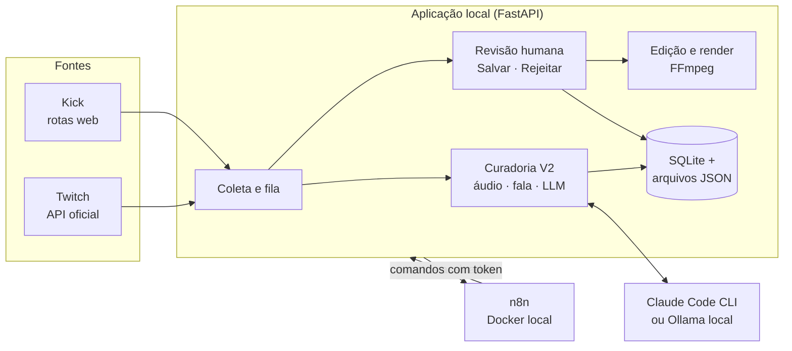
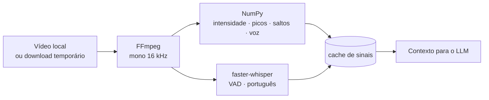
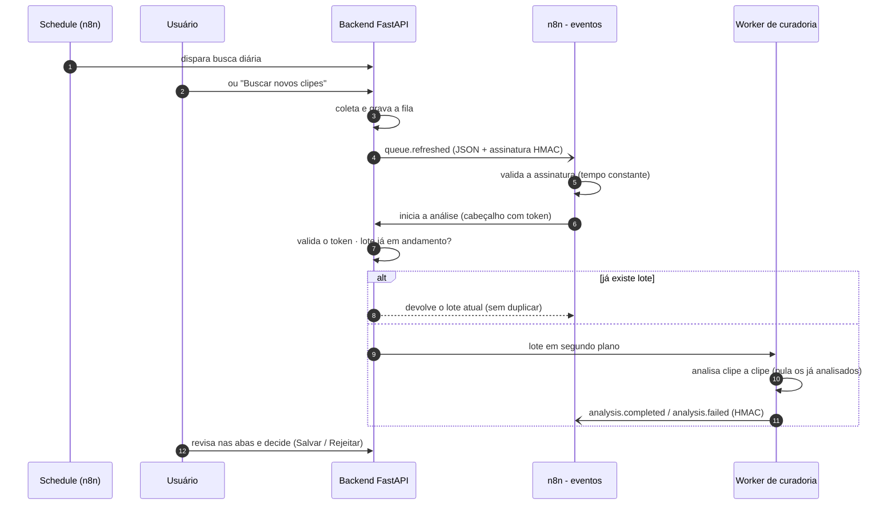

# Twitch Highlights: curadoria de clipes com IA aplicada e automação

> **Estudo de caso.** Este repositório documenta um projeto pessoal cujo
> código-fonte é **privado**. Aqui estão a arquitetura, as decisões de
> engenharia, a automação e os resultados experimentais medidos. Não estão o
> código, os prompts, os parâmetros de classificação nem os dados de uso.

**Stack:** Python · FastAPI · JavaScript sem framework · SQLite · FFmpeg ·
NumPy · faster-whisper · Claude Code CLI · Ollama · n8n · Docker · pytest ·
Chrome headless (CDP)

---

## Sumário

1. [Apresentação](#1-apresentação)
2. [Problema e motivação](#2-problema-e-motivação)
3. [Visão geral da solução](#3-visão-geral-da-solução)
4. [Funcionalidades: V1](#4-funcionalidades-v1-curadoria-manual-e-edição)
5. [Funcionalidades: V2](#5-funcionalidades-v2-curadoria-inteligente)
6. [Arquitetura técnica](#6-arquitetura-técnica)
7. [Automação e orquestração com n8n](#7-automação-e-orquestração-com-n8n)
8. [Curadoria com LLMs](#8-curadoria-com-llms)
9. [Observabilidade e testes](#9-observabilidade-e-testes)
10. [Resultados experimentais](#10-resultados-experimentais)
11. [Limitações](#11-limitações)
12. [Roadmap de evolução](#12-roadmap-de-evolução)
13. [Escopo público e privacidade](#13-escopo-público-e-privacidade)

---

## 1. Apresentação

O **Twitch Highlights** é uma aplicação local para curadoria de clipes da
Twitch e da Kick. Ela apoia todo o ciclo de produção de compilações de
melhores momentos: **coletar → revisar → decidir → editar → renderizar**.

O projeto evoluiu em duas versões:

- **V1, curadoria manual e edição:** uma ferramenta de produtividade para
  revisar centenas de clipes por dia e montar vídeos.
- **V2, curadoria inteligente:** uma camada opcional de IA aplicada. Ela
  analisa áudio e fala, produz recomendações estruturadas e explicáveis e
  propõe uma ordem de revisão. A decisão final continua sempre humana.

| Dimensão | Valor |
|---|---|
| Backend da V1 (Python) | ~3.200 linhas |
| Módulo de curadoria da V2 (Python) | ~4.000 linhas em 25 módulos |
| Interface (JS, HTML e CSS) | ~4.700 linhas |
| Rotas HTTP | 64 |
| Testes automatizados | 98 testes Python (24 da V1, 74 da V2) e 2 suítes de navegador |

---

## 2. Problema e motivação

Montar uma compilação diária exige assistir a **200–300 clipes**, vindos de
dezenas de canais, para aproveitar uma pequena fração. Os problemas
observados eram:

- **Tempo:** a revisão manual consome mais tempo do que a edição.
- **Viés de popularidade:** as plataformas ordenam por visualizações. Clipes
  bons de canais pequenos ficam no fim da fila.
- **Conteúdo visual:** em jogos como League of Legends, muitos momentos bons
  são jogadas silenciosas. Um sistema que só "ouve" tende a descartá-los.
- **Fragmentação:** busca, revisão, download e edição ficavam em ferramentas
  diferentes.

**Pergunta que orientou a V2:** é possível reduzir o esforço de triagem com
LLMs **sem perder clipes bons**, de forma mensurável, local e sem APIs pagas
por token?

---

## 3. Visão geral da solução

**Princípios de projeto:**

1. **A IA recomenda; o humano decide.** Nenhum clipe é removido
   automaticamente.
2. **Tudo é opcional.** Sem Whisper, LLM ou n8n, o fluxo manual da V1
   funciona integralmente.
3. **Local e sem custo por token.** Os modelos são acessados por uma CLI
   (Claude Code, pela assinatura existente) ou rodam localmente (Ollama).
4. **Medir antes de afirmar.** Cada etapa registra tempo, consumo e
   resultado, e os resultados só são reportados com base em dados.

---

## 4. Funcionalidades: V1 (curadoria manual e edição)

| Funcionalidade | Descrição | Estágio |
|---|---|---|
| Coleta por canais | Clipes das últimas 24 h de cada canal cadastrado, com limite por canal, progresso em tempo real e isolamento de falhas (um canal com erro não interrompe os demais) | ✅ |
| Integração Twitch | API oficial Helix com token de aplicativo | ✅ |
| Integração Kick | Rotas públicas do site, com rota alternativa e endpoint de diagnóstico | ✅ (não oficial) |
| Descoberta por categoria | Clipes de League of Legends em português fora dos canais cadastrados | ✅ |
| Termos proibidos | Lista de exclusão aplicada aos títulos em todas as buscas | ✅ |
| Revisor | Player MP4/HLS, conversão automática quando o codec não é suportado pelo navegador, loop, velocidades de 1× a 3×, atalhos de teclado | ✅ |
| Decisões | **Salvar** (aceito), **Rejeitar**, **Próximo** (só navega), **Anterior**, **Desfazer** | ✅ |
| Listas persistentes | Aceitos e rejeitados persistidos separadamente (JSON e TXT), sem sobreposição | ✅ |
| Exportação | TXT (links) ou JSON (dados + rótulo), escolhendo aceitos ou rejeitados | ✅ |
| Download | Download local do clipe via yt-dlp | ✅ |
| Editores PC e celular | Linha do tempo com dividir, remover em sequência e unir, forma de onda, recorte de tela, normalização de volume e edição salva sem renderizar | ✅ |
| Vídeo final | Montagem dos clipes editados com vinhetas de introdução e intermediário, com progresso da renderização | ✅ |
| Modo bloco | Edição de vários clipes como um projeto | 🟡 parcial (sem atalho na tela de revisão) |

---

## 5. Funcionalidades: V2 (curadoria inteligente)

| Funcionalidade | Descrição | Estágio |
|---|---|---|
| Pipeline de análise | Mídia → áudio → transcrição → contexto → LLM → validação → decisão | ✅ |
| Sinais de áudio | Intensidade, picos, saltos bruscos e energia na faixa da voz | ✅ |
| Transcrição local | faster-whisper com filtro de voz (VAD) | ✅ |
| Cache incremental | Sinais e transcrições guardados; reanalisar com outro modelo não baixa nem transcreve de novo | ✅ |
| Saída estruturada | JSON Schema com critérios, confiança, incerteza, evidências e limitações | ✅ |
| Múltiplos provedores | Claude Code CLI e Ollama local, com fallback, e um modo **sem IA** | ✅ |
| Recomendação explicável | Três estados (recomendado, revisar, baixa prioridade), definidos por regras determinísticas e auditáveis | ✅ |
| Ordenação com diversidade | Ordem sugerida que distribui melhor os canais no topo, sem remover clipes | ✅ |
| Integração ao revisor | Abas **Ordem original × Recomendada (IA)**, com progresso, posições independentes e selo discreto expansível com a análise | ✅ |
| Análise automática | Iniciada ao fim de cada busca | ✅ |
| Painel de métricas | Qualidade (teste cego × assistido), ordenação, diversidade, tempos, recursos e uso dos provedores | ✅ |
| Observabilidade | Logs estruturados, tempo por etapa, tentativas, tokens, CPU/RAM/GPU/VRAM | ✅ |
| Automação com n8n | Eventos assinados, endpoint protegido por token e workflows versionados | ✅ |
| Análise de chat | Reação do chat sincronizada ao clipe | 🟡 implementada, **desligada por padrão** (depende de APIs não oficiais) |
| Telas dedicadas de aceitos e rejeitados | Navegação pelas listas na interface | 🔵 planejada (hoje acessadas pela exportação) |
| Dataset e modelo próprio | Ver [Roadmap](#12-roadmap-de-evolução) | 🔵 planejado |

---

## 6. Arquitetura técnica

### 6.1 Componentes

| Camada | Tecnologia | Responsabilidade |
|---|---|---|
| Interface | HTML, CSS e JS sem framework, hls.js | Revisor, editores, painel de métricas |
| API | FastAPI (Python) | Coleta, revisão, mídia, edição, curadoria, automação |
| Persistência | Arquivos JSON/TXT + SQLite (WAL) | Fila e listas em arquivos; curadoria, rótulos, eventos e métricas no SQLite |
| Mídia | yt-dlp, FFmpeg | Download, conversão, extração de áudio e renderização |
| Sinais | NumPy | Medidas de áudio em janelas curtas |
| Transcrição | faster-whisper (CTranslate2) | Fala → texto, local |
| LLM | Claude Code CLI · Ollama | Análise editorial estruturada |
| Orquestração | n8n em Docker | Agendamento e reação a eventos |
| Medição | psutil, NVIDIA NVML | CPU, RAM, GPU e VRAM |

### 6.2 Coleta e filas

- Cada canal é consultado de forma independente, e falhas ficam isoladas por
  canal.
- A fila é gravada atomicamente (arquivo temporário seguido de troca), com um
  identificador de geração.
- A **ordem original** segue a posição dos canais e, dentro de cada canal, a
  popularidade. A V2 preserva esse comportamento como padrão e oferece uma
  ordem alternativa.
- Uma fila nova reinicia automaticamente o estado de revisão e as posições.

### 6.3 Revisão humana e rótulos

- Cada decisão gera um **evento de revisão**. O evento registra o tempo
  desde a exibição do clipe, a aba usada (original ou IA), se a análise
  estava visível e a recomendação e a posição sugeridas naquele momento.
- **Salvar** e **Rejeitar** são os únicos atos que geram rótulo. **Próximo**
  só navega. Essa separação foi introduzida depois de um incidente real: a
  navegação sobrescrevia decisões anteriores.
  - O sistema ganhou um **recálculo dos rótulos a partir do histórico de
    eventos**, com backup prévio e trilha de auditoria.
  - Ele restaurou integralmente o conjunto de validação.
- Os rótulos têm **prioridade por fonte**: uma decisão explícita no revisor
  prevalece sobre o histórico importado.

### 6.4 Processamento de áudio e o papel do Whisper

- **Sinais de áudio:** são calculados sobre o nível típico do próprio clipe, e
  não em valores absolutos. Assim, um áudio alto e constante não é tratado
  como evento. A energia na faixa da voz separa um grito de reação de um
  estrondo do jogo.
- **O Whisper só transcreve.** Ele não julga o clipe. O modelo foi escolhido
  por medição: um modelo menor era cerca de 3× mais rápido, mas **inventou
  frases** nos testes. O `large-v3-turbo` em CPU int8 foi o melhor equilíbrio
  entre qualidade e custo.
- **Cache e limpeza:** sinais e transcrição ficam guardados por clipe e por
  configuração. Vídeos baixados só para análise são apagados depois da
  extração, e os downloads do usuário nunca são tocados.

### 6.5 Comparação entre a ordem original e a recomendada

O revisor tem **duas abas no topo**:

- **Ordem original:** a mesma da V1, que é o padrão.
- **Recomendada (IA):**
  - mostra a porcentagem da fila já analisada e libera em 100%;
  - **cada aba mantém a própria posição**, então é possível alternar sem
    perder o ponto em nenhuma delas;
  - as decisões valem nas duas, porque o clipe é o mesmo.

Isso permite comparar as duas estratégias no uso real. Os eventos de revisão
registram em qual aba cada decisão foi tomada, o que alimenta as métricas de
teste cego e assistido.

### 6.6 Exportação e edição

- **Exportação:** escolhe-se entre **aceitos** e **rejeitados**, e o JSON
  inclui o rótulo de cada clipe. Isso já prepara a base do dataset descrito
  no roadmap.
- **Edição:**
  - é não destrutiva: as "receitas" de edição são salvas separadamente e
    renderizadas sob demanda com FFmpeg;
  - inclui normalização de volume em duas passagens;
  - o vídeo final junta os clipes editados na ordem definida pelo usuário.

---

## 7. Automação e orquestração com n8n

### 7.1 Papel do n8n

O n8n é a **camada de orquestração**: decide **quando** e **em resposta a
quê** o backend executa tarefas. Ele **não processa clipes nem reimplementa
regras de negócio**. Toda a lógica (coleta, análise, decisão e persistência)
fica no backend Python, que é a fonte única de verdade. O n8n só emite
comandos para o backend e reage aos eventos dele.

| Responsabilidade | Onde fica |
|---|---|
| Agendar a busca diária de clipes | n8n |
| Reagir ao fim de uma busca disparando a análise | n8n |
| Registrar o resultado dos lotes (histórico de execuções) | n8n |
| Coletar, analisar, decidir, persistir | Backend |
| Emitir eventos e validar comandos | Backend |
| Aprovar ou rejeitar clipes | **Humano** |

### 7.2 Fluxos automatizados

**Workflow 1, eventos do backend** (publicado):

1. Um **webhook** recebe o evento.
2. Um **Code node** recalcula a assinatura **HMAC-SHA256** do corpo e a
   compara em tempo constante. Se não bater, a execução falha e fica
   registrada como erro.
3. Um **IF** separa os tipos de evento:
   - `queue.refreshed` → um **HTTP Request** chama o endpoint de automação
     do backend, autenticado por token, e inicia a análise da fila;
   - `analysis.completed` / `analysis.failed` → seguem para um ramo de
     registro, e o resultado do lote fica no histórico de execuções do n8n.

**Workflow 2, busca diária** (importado **desativado**):

- Um **Schedule Trigger** dispara a mesma busca do botão "Buscar novos
  clipes".
- Ao terminar, o backend emite `queue.refreshed`, o que aciona o workflow 1.
- Os fluxos se **encadeiam por eventos**, não por lógica duplicada.

### 7.3 Fluxo de ponta a ponta

### 7.4 Integração entre serviços: autenticação e validação

| Direção | Mecanismo | Detalhes |
|---|---|---|
| Backend → n8n | **Webhook com assinatura HMAC-SHA256** | Corpo JSON compacto, para que o receptor reproduza exatamente os bytes assinados; o tipo do evento vai no cabeçalho |
| n8n → Backend | **Token compartilhado em cabeçalho** | Comparação em tempo constante; sem token configurado, o endpoint de automação fica **desativado** (403); token inválido → 401 |
| Eventos aceitos | Lista fechada | `queue.refreshed`, `analysis.completed`, `analysis.failed`; qualquer outro é rejeitado na emissão |

- O backend **nunca bloqueia nem falha** por causa do n8n. Os eventos são
  enviados em segundo plano, e o sucesso ou a falha do envio fica no log
  estruturado. Sem n8n configurado, nada é enviado.
- Os segredos ficam em variáveis de ambiente. Os workflows versionados só
  **referenciam** essas variáveis, sem valores embutidos.

### 7.5 Execução com Docker

- O n8n roda num **Docker Compose** dedicado, com volume próprio.
- A porta fica publicada **apenas no localhost**.
- O container recebe **somente** as variáveis da automação. As credenciais
  das plataformas não entram nele.
- Telemetria, templates e checagem de versão do n8n ficam desligados, e não
  há notificações externas.
- O backend é alcançado a partir do container pelo host do Docker.
- Os workflows são importados e publicados pela **CLI do n8n**, de forma
  reproduzível. Ativar a busca diária é uma **decisão manual** do usuário.

**Exige intervenção humana:**

- ativar ou desativar workflows e configurar os segredos;
- **todas as decisões de curadoria**.

Nada é publicado automaticamente.

### 7.6 Confiabilidade

O que está comprovado no código e em testes:

| Aspecto | Comportamento |
|---|---|
| Disparos concorrentes | A interface e o n8n podem pedir a mesma análise; o backend devolve o lote em andamento, sem duplicar |
| Reprocessamento | Clipes já analisados com a mesma versão são pulados; lotes podem ser parados e retomados |
| Falhas por clipe | Um erro num clipe é registrado e o lote segue |
| Falhas do LLM | Nova tentativa com a mensagem de erro de validação, fallback de provedor e pausa do lote ao atingir o limite de uso |
| Eventos inválidos | Execução marcada como erro no n8n (auditável) |
| Monitoramento | Histórico de execuções do n8n + logs estruturados + tabela de lotes do backend (status, contagens, duração, gatilho) |
| Limite conhecido | O envio de eventos do backend é **uma tentativa** (sem fila de reenvio); a falha fica registrada em log |

**Validação real (16/11/2026):**

- Um evento assinado corretamente gerou uma execução com sucesso.
- Um evento com assinatura falsa gerou uma execução com erro.
- `queue.refreshed` levou o n8n a disparar a análise: o backend registrou o
  lote com origem "n8n", pulou os clipes já analisados e emitiu
  `analysis.completed` ao final.
- A chamada sem token foi recusada.

### 7.7 Por que n8n junto com Python?

> A regra "o n8n orquestra, o backend processa" está documentada nas
> decisões de arquitetura do projeto. A justificativa abaixo, sobre por que
> usar o n8n em vez de agendar tudo no próprio backend, é uma
> **interpretação técnica** das vantagens observadas.

- **Separação de responsabilidades:** *quando* executar (agendas e reações)
  muda com mais frequência do que *como* processar. No n8n, isso se ajusta
  sem alterar nem reiniciar o backend.
- **Auditoria visual:** cada execução fica registrada com entrada, ramo
  percorrido e erro, sem construir uma tela para isso.
- **Ponto de extensão:** notificações ou integrações futuras se conectam aos
  eventos que já existem, sem tocar no núcleo.
- **Contratos explícitos:** eventos tipados e assinados, mais comandos
  autenticados, formam uma interface estável entre os dois lados. Isso
  também facilita trocar o orquestrador no futuro.
- **Custo controlado:** como o n8n não executa lógica, não há duplicação nem
  divergência de regras entre os sistemas.

---

## 8. Curadoria com LLMs

### 8.1 Um modelo por clipe, com saída estruturada

**Não é um sistema multiagente.** Cada clipe é analisado por **um** LLM; os
demais só entram como fallback quando o anterior falha.

O modelo recebe um relatório do clipe (título, medidas de áudio,
transcrição e, opcionalmente, o chat) e devolve um **JSON validado por
schema** com:

- notas para **cinco critérios editoriais**: humor/reação, acontecimento,
  compreensão sem contexto, potencial de edição e comunicação;
- **confiança** e indicadores explícitos de **informação suficiente** e de
  **necessidade de revisão visual**;
- categoria, resumo, justificativa, **evidências citando a fonte** e
  limitações.

A resposta passa por **validação semântica**. Uma evidência atribuída a uma
fonte indisponível invalida a resposta, e uma resposta inválida gera nova
tentativa com o erro descrito.

### 8.2 O programa decide, não o modelo

- O LLM produz **notas**. Um módulo determinístico converte as notas em nota
  final, recomendação e ordem.
- **O desenho é deliberadamente avesso a falsos negativos:** um clipe só é
  rebaixado quando a informação é suficiente, a confiança é alta e não há
  dependência visual. Na dúvida, ele vai para "revisar".
- **Clipes com pouca fala** são marcados para revisão visual pelo próprio
  programa, mesmo que o modelo não peça. É a proteção para jogadas
  silenciosas.
- As regras são explícitas e versionadas, o que permite auditá-las e
  recalibrá-las com dados. Os parâmetros não são publicados aqui.

### 8.3 Popularidade não é qualidade

Visualizações, seguidores, tamanho do canal e **nomes** (do streamer e de
quem clipou) **não entram** no prompt, na nota nem na ordenação. Testes
automatizados garantem isso.

O objetivo é dar a clipes de canais pequenos a mesma chance e evitar que o
modelo seja influenciado por nomes conhecidos.

### 8.4 Provedores

| Provedor | Execução | Custo | Uso |
|---|---|---|---|
| **Claude Code CLI** | Modo headless, **sem ferramentas**, sem servidores MCP, sem persistência de sessão, em diretório temporário isolado; dados por stdin | Sem cobrança por token; consome os limites do plano | Provedor principal |
| **Ollama** (`qwen3:8b`) | HTTP local com saída restrita por schema; contexto dimensionado para caber inteiro numa GPU de 8 GB | Gratuito | Fallback e comparação |
| **Sem IA** | Só sinais de áudio e fala | Gratuito | Linha de base; nunca rebaixa clipes |

A escolha do modelo local foi medida. Um modelo multimodal já instalado
ignorava o modo sem raciocínio e, com contexto maior, transbordava para a
CPU, levando minutos por clipe. O modelo textual coube inteiro na GPU.

### 8.5 Segurança contra injeção de instruções

- O conteúdo do clipe (título, falas, chat) é **dado, nunca instrução**:
  ele vai serializado em JSON dentro de um bloco delimitado e escapado.
- Nada desse conteúdo é colocado em argumentos de linha de comando.
- O subprocess roda **sem shell**, e o modelo **não tem ferramentas**.
- O modelo **não executa ações**: não apaga, não publica e não altera listas.

### 8.6 Por que não usar tool calling

Foi uma decisão arquitetural registrada. O classificador já recebe todos os
dados de uma vez. Dar ferramentas ao modelo enquanto ele lê conteúdo não
confiável aumentaria a superfície de injeção **sem trazer informação nova**.
Um uso legítimo futuro seria um servidor de consulta somente leitura.

---

## 9. Observabilidade e testes

### 9.1 Observabilidade

| Sinal | Como é registrado |
|---|---|
| Eventos | Logs estruturados em **JSON Lines**, com rotação |
| Tempo | Duração de cada etapa (mídia, áudio, transcrição, chat, contexto, LLM) por clipe |
| Provedores | Cada tentativa: status, duração, código de saída, erro, **tokens informados pelo próprio provedor** |
| Recursos | Amostragem por segundo de CPU e RAM (app, processos filhos e Ollama) e de GPU e VRAM, com uma **medição de referência antes do lote** |
| Lotes | Status, contagens, duração, gatilho (interface, CLI, n8n) e resumo de recursos |
| Decisões humanas | Eventos de revisão com contexto (aba, IA visível, tempo de decisão) |

O **painel de métricas** calcula tudo a partir desses registros:

- falsos negativos;
- precisão do "recomendado";
- posição dos aprovados em cada ordenação;
- diversidade;
- tempos;
- recursos;
- uso dos provedores.

Quando não há dados suficientes, o valor aparece como indisponível, e não
como estimativa.

### 9.2 Estratégia de testes

| Camada | O que é coberto | Como |
|---|---|---|
| Sinais | Silêncio, áudio alto constante, grito, estrondo grave, chat movimentado sem reação, rajada de risadas | Sinais sintéticos gerados no teste |
| Decisão | Regras contra falsos negativos, clipe silencioso, ordenação, diversidade, **views ignoradas** | Unitários |
| Orquestrador | Provedor indisponível, limite de uso, saída inválida, timeout, fallback, **injeção de instruções**, isolamento do comando do CLI | **Provedores simulados**: nenhum teste consome cota |
| Pipeline | Persistência, vídeo ausente, cache, modo sem IA, pausa com registro de recursos, recálculo de rótulos, migração de dados | Banco temporário |
| API | Fila com recomendações, eventos de revisão, token de automação, disparo concorrente | TestClient |
| Webhooks e n8n | HMAC verificável, falha isolada, eventos desconhecidos; workflows chamam só o backend local, conferem a assinatura e enviam o token | Transporte simulado + verificação estática |
| V1 | Fila, download, listas, editores, renderização | Unitários e de integração |
| Navegador | Editores PC/celular, vídeo final, linha do tempo; abas, selo da IA, Rejeitar/Desfazer e posições independentes | **Chrome headless via DevTools Protocol**, com escritas simuladas para não tocar dados reais |
| Modelos reais | Resposta válida de Claude e Ollama | **Desligados por padrão** (exigem opt-in explícito) |

**Resultado da última verificação (16/11/2026):**

- **96 testes aprovados e 2 pulados** (os de modelos reais), tanto no projeto
  quanto numa **cópia limpa**, equivalente a um clone novo, sem dados nem
  credenciais.
- As suítes de navegador também foram aprovadas.
- Na cópia limpa, a aplicação subiu do zero e passou por testes de ponta a
  ponta:
  - criação e persistência de aceitos e rejeitados;
  - exportação;
  - automação sem token bloqueada;
  - análise "sem IA" com FFmpeg e Whisper reais, incluindo o reaproveitamento
    do cache.

---

## 10. Resultados experimentais

> Validação inicial, de 16/11/2026, numa máquina de mesa com GPU de 8 GB. São
> **números medidos, não estimados**. A amostra é pequena; leia junto com as
> [limitações](#11-limitações).

### 10.1 Da V1 para a V2

| Aspecto | V1 | V2 |
|---|---|---|
| Ordem da fila | Posição do canal + popularidade | Opcional: recomendação + diversidade, **sem popularidade** |
| Informação por clipe | Título e metadados | Notas por critério, confiança, justificativa, limitações, aviso de revisão visual |
| Remove clipes? | Não | Não; só reordena |
| Rótulos | Só aprovados | Aceitos × rejeitados explícitos, com histórico e contexto |
| Automação | Manual | Opcional: n8n com eventos assinados |
| Observabilidade | Saída no console | Logs estruturados, tempos, tokens, recursos e painel de métricas |
| Custo monetário adicional | — | Nenhum medido |

### 10.2 Teste cego

O conjunto tem **22 clipes, 5 aprovados e 17 rejeitados**. O curador decidiu
**sem ver a IA**, e os clipes foram analisados depois.

| Medida | Claude Code | Ollama (local) |
|---|---|---|
| Falsos negativos (aprovado enviado à baixa prioridade) | 0 de 5 | 0 de 5 |
| Aprovados marcados como "recomendado" | 1 de 5 | 4 de 5 |
| Recomendados que o curador aprovou | 1 de 1 | 4 de 7 |
| Rejeitados enviados à baixa prioridade | 1 de 17 | 0 de 17 |
| Distribuição | 1 recomendado · 20 revisar · 1 baixa | 7 recomendados · 15 revisar · 0 baixa |

**Ordenação: quantos clipes é preciso ver para encontrar todos os aprovados**

| Estratégia | Posições dos aprovados | Clipes vistos até o último |
|---|---|---|
| Ordem original (plataforma) | 3, 4, 11, 13, 20 | 20 de 22 |
| Sem IA (só sinais) | 1, 6, 11, 19, 21 | 21 de 22 |
| V2 com Claude Code | 1, 2, 3, 10, 18 | 18 de 22 |
| V2 com Ollama | 1, 2, 3, 6, 10 | **10 de 22** |

**Leitura honesta:**

- **Zero falso negativo não significa classificação excelente.** O resultado
  decorre em boa parte da estratégia conservadora. O Claude mandou 20 dos 22
  clipes para "revisar", e por isso a triagem efetiva foi pequena.
- **O ganho mensurável está na ordem.** Com os dois provedores, os três
  primeiros clipes sugeridos foram aprovados pelo curador.
- **O modelo local ordenou melhor nesta amostra**, mas recomendou três clipes
  rejeitados. Com 5 positivos, a diferença é **indicativa, não conclusiva**.
- **A linha de base só com sinais foi pior que a ordem original.** Volume e
  quantidade de fala, sozinhos, não indicam qualidade. Isso justifica o uso
  de um modelo de linguagem.
- **A revisão visual foi marcada em ~96% dos clipes.** Esse é o principal
  limite para conteúdo de jogo.

### 10.3 Desempenho e recursos

| Medida | Valor |
|---|---|
| Processamento por clipe, mediana | **22,7 s** |
| Transcrição, mediana | 9,2 s (CPU) |
| LLM Claude Code, mediana | 12,9 s |
| LLM Ollama, mediana (com sinais em cache) | 8,8 s |
| Tokens por clipe, informados pelos provedores | Claude ≈ 7,6 mil de entrada / 2,0 mil de saída · Ollama ≈ 1,9 mil / 0,5 mil |
| CPU na transcrição | ≈ 3,8 núcleos em média |
| RAM do app | ≈ 1,1 GB (pico 1,4 GB) |
| GPU/VRAM com Ollama | GPU a 93–94%; +6,0 GB de VRAM (pico de 7,9 de 8 GB) |
| GPU/VRAM com Claude | Sem uso local (o modelo é remoto) |
| Falhas finais | 0 em 74 análises; 1 erro transitório do CLI em 53 chamadas, **recuperado automaticamente** |
| Diversidade nos 10 primeiros da fila | 7 → 10 canais distintos (fila de 52 clipes) |
| Custo monetário adicional | Nenhum medido |

### 10.4 O que ainda não foi medido

- **Ganho de produtividade humana.** Existe a linha de base manual (mediana
  de **20,8 s por decisão**, em 23 decisões), mas o **teste assistido ainda
  não foi concluído**. **Nenhum ganho de produtividade é afirmado.**
- O volume de 200–300 clipes por dia não foi executado de ponta a ponta, nem
  foi verificado se ele cabe nos limites do plano do provedor remoto.

---

## 11. Limitações

**Metodológicas:**

- Amostra pequena: 22 clipes, **5 aprovados**. Um único clipe muda as
  proporções em 20 pontos.
- Uma única fila (League of Legends em português, Twitch), **sem clipes da
  Kick**, e um único curador.
- O conjunto de validação não será reutilizado para ajustar parâmetros e
  depois apresentado como avaliação independente.

**Técnicas:**

- A IA **não vê o vídeo**: usa só áudio, fala e título. Em jogos visuais,
  isso empurra a maioria dos clipes para "revisar".
- O provedor remoto é **conservador demais** nesta configuração.
- O CLI remoto consome os limites do plano do usuário, sem garantia de
  volume.
- A Kick e o chat usam **rotas não oficiais**, que podem mudar sem aviso.
- A transcrição roda em CPU; a aceleração por GPU exige bibliotecas
  adicionais e ainda não foi medida.
- GPU e VRAM são medidas do sistema inteiro e podem incluir outros programas.
- O app foi feito para uso **local e de um único usuário**, sem login.
- O modo bloco do editor é parcial, e o envio de eventos ao n8n não tem fila
  de reenvio.

---

## 12. Roadmap de evolução

> **Proposta futura.** Nenhum modelo próprio foi treinado.

### 12.1 Dataset de curadoria

O sistema **já registra** decisões explícitas de **aceito × rejeitado**, com
data, tempo de decisão, contexto (aba e se a IA estava visível), histórico de
correções e a análise de cada clipe (sinais, transcrição, notas, confiança,
versão do modelo e do prompt).

**Próximos passos:**

- **Exportação de um dataset unificado e pseudonimizado.**
- **Telas dedicadas** para navegar pelos clipes aceitos e rejeitados
  (planejadas).
- Separar **dados de treino** (features derivadas e rótulo) de **dados
  operacionais** (logs, tempos, recursos).
- **Não** guardar áudio nem vídeo de terceiros; respeitar os termos das
  plataformas.
- Manter popularidade e identidade dos canais **fora** das features. A
  identidade só serve para agrupar os dados na divisão treino/teste.

### 12.2 Modelo especializado

Abordagens a comparar, da mais simples para a mais cara:

1. Classificadores supervisionados sobre sinais de áudio e fala (linha de
   base interpretável).
2. Texto (embeddings locais da transcrição) combinado com sinais.
3. **Modelos de ranking**, otimizando diretamente a ordem da fila.
4. As notas do LLM como features de um modelo próprio.
5. Fine-tuning **somente** se houver dados suficientes e as etapas anteriores
   estagnarem.
6. Abordagens multimodais, caso a análise visual seja incorporada depois de
   medir custo e ganho.

### 12.3 Metodologia de avaliação

- **Comparação:** ordem original × só sinais × Claude × Ollama × modelo
  próprio.
- **Métricas:**
  - precisão, recall, F1, falsos positivos e falsos negativos;
  - Recall@k e NDCG;
  - clipes examinados até encontrar todos os aceitos;
  - calibração da confiança;
  - tempo e custo por clipe;
  - CPU, RAM, GPU e VRAM;
  - **tempo de revisão humana** em teste assistido.
- **Sem vazamento de dados:**
  - divisão temporal;
  - agrupamento por canal e por transmissão de origem;
  - conjunto de teste intocado até o fim;
  - decisões cegas e assistidas analisadas separadamente.

**Objetivo de pesquisa:** verificar se um modelo treinado com decisões
humanas reais supera, em dados não vistos, as estratégias atuais na
identificação de bons clipes, na ordenação, no tempo de curadoria e no custo.
É uma hipótese a testar, não um resultado garantido.

---

## 13. Escopo público e privacidade

Este estudo de caso **divulga**:

- tecnologias;
- arquitetura;
- mecanismos de integração;
- decisões de engenharia;
- estratégia de testes;
- resultados agregados.

**Não divulga, intencionalmente:**

- código-fonte;
- prompts;
- pesos, limiares e fórmulas de classificação;
- exports dos workflows;
- configurações e credenciais;
- bancos de dados;
- listas de canais monitorados;
- títulos, links ou identificadores de clipes;
- transcrições.

Os resultados experimentais são agregados e não permitem identificar clipes
ou canais.

O código-fonte completo permanece privado. Detalhes técnicos adicionais podem
ser apresentados em entrevista.
